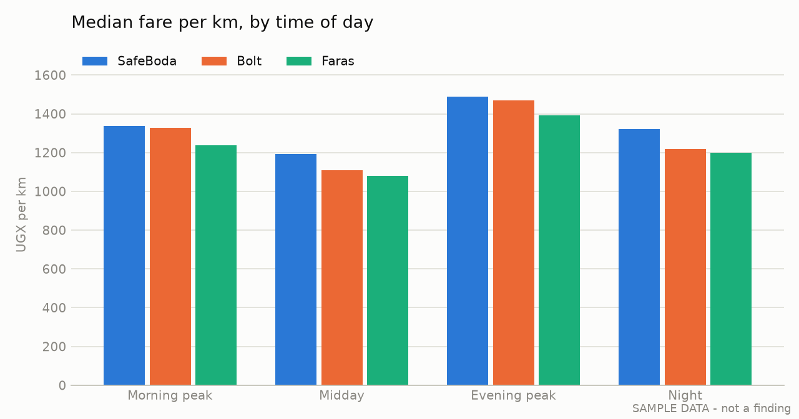

# Kampala ride-hailing fare and wait-time study

Uber stopped operating in Uganda on 2 September 2026
([Daily Monitor](https://www.monitor.co.ug/uganda/news/national/end-of-an-era-uber-exits-uganda-nigeria-after-decade-in-market-5581500),
[TechPoint Africa](https://techpoint.africa/news/uber-exits-nigeria-uganda/)). This study compares what the
remaining apps quote for the same boda trip at the same moment, and how long a rider
waits, across a set of Kampala routes and times of day.

**Status: collecting data.** No findings yet. The charts and tables in this README will
be filled in from `out/` once logging is complete.

This is an independent personal study, not affiliated with SafeBoda, Bolt or Faras.



*The chart above is made-up sample data that shows what the pipeline produces. It is not a finding.*

## Questions

1. How does fare per km differ between SafeBoda, Bolt and Faras, and does the gap change
   at peak hours?
2. On which routes is each app priced above or below its cheapest rival?
3. Does a higher fare buy a shorter pickup ETA?

## Method

A quote is the fare and pickup ETA an app shows on its booking screen **before** the trip
is confirmed, so no trip has to be taken. For each observation, open all three apps within
two minutes of each other, enter the same pickup and drop-off, and log one row per app.

- **Routes:** 5 to 8 fixed routes, listed with their road distance in `data/routes.csv`.
- **Times:** each route in each band where possible: morning peak (07:00–10:00), midday
  (10:00–16:00), evening peak (16:00–20:00), night (20:00–07:00).
- **Target:** at least 60 rows over 3 to 4 days, and at least 3 quotes per app in each band.
- **Pickup point:** stand at the route's origin. ETA depends on where the phone is.

### Logging a row

Add rows to `data/quotes.csv`, or to a Google Sheet with the same columns and download it
as CSV over that file.

| Column | Example | Notes |
| --- | --- | --- |
| `date` | `2026-10-13` | |
| `time` | `08:15` | 24-hour clock; the time band is derived from it |
| `route_id` | `R1` | must exist in `data/routes.csv` |
| `app` | `SafeBoda` | exactly `SafeBoda`, `Bolt` or `Faras` |
| `vehicle` | `boda` | `boda` or `car` |
| `fare_ugx` | `6500` | the quoted fare before any promo code; midpoint if a range is shown |
| `eta_min` | `4` | pickup ETA in minutes |
| `surge_shown` | `n` | `y` if the app flags higher demand |
| `notes` | `raining` | weather, events, promo banners |

`data/routes.csv` needs one row per route: `route_id,origin,destination,km`, with `km`
taken from Google Maps for the route a boda would use.

## Running it

```bash
uv run analysis.py            # real data  -> out/
uv run analysis.py --sample   # made-up rows -> out/sample/, to test the pipeline
uv run analysis.py --vehicle car
uv run analysis.py --focus Bolt   # chart Bolt against its cheapest rival
```

It writes `summary.md` (every table, including each app's fare against its cheapest rival
on each route) and three charts: fare per km by time of day, pickup ETA by time of day, and
the `--focus` app's fare against its cheapest rival on each route (default SafeBoda). It
stops with a message if a route has no distance or an app name is misspelt.

## Limits

- Quotes are not completed-trip prices; the final fare can differ.
- One phone and one account per app, so any personalised pricing or promo is not controlled for.
- A few routes over a few days cannot describe the whole city.
- This shows the rider's side only. See `interviews.md` for the driver's side.

## Experiment proposals

Drafts are in [`experiments.md`](experiments.md). They are hypotheses to be kept, changed
or dropped once the data is in.

## License

[MIT](LICENSE)
